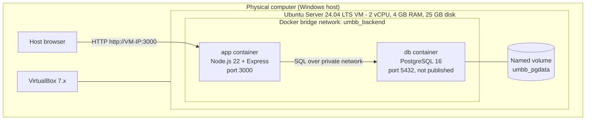
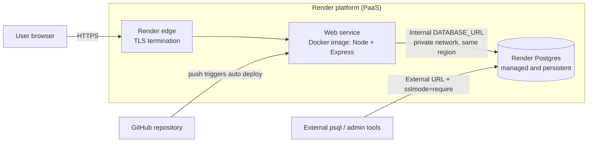
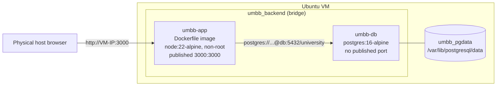

# Design, Deployment and Comparison of a Dynamic University Web Application

**Institution:** L’Université M'Hamed BOUGARA de Boumerdès (UMBB)
**Application:** UMBB University Portal
**Environments:** VirtualBox + Ubuntu Server + Docker (IaaS-style), and Render (PaaS)
**Team:** [Member names and student numbers]
**Module / date:** [Module code, submission date]

> **Note on evidence.** Values and screenshots marked with square brackets must
> be replaced with the results captured on the team's own VM and Render account.
> The Docker and application results described in Sections 5 and 6 were
> reproduced on the development host with the same `docker-compose.yml` used in
> the VM runbook. Mermaid diagrams can be rendered at <https://mermaid.live> or
> in a Markdown viewer with Mermaid support.

## Abstract

This report describes a small dynamic web application for L’Université M'Hamed
BOUGARA de Boumerdès and its deployment in two environments. The application provides
public department and announcement pages and a protected administration area
for announcement management. It uses Node.js, Express, EJS and PostgreSQL. In
the first environment, the application and database run in separate Docker
containers inside an Ubuntu Server virtual machine hosted by VirtualBox. In the
second, the same Docker image runs as a Render web service connected to a
managed Render PostgreSQL database. The report compares the two environments in
terms of complexity, control, resource management, networking, persistence,
maintenance, scalability and cost, and recommends an approach for the
university.

## 1. Requirements and scope

The application is deliberately small. It demonstrates a multi-tier
architecture, a relational data store, authenticated write operations and
persistent data rather than a complete university information system.

| Requirement | Implementation |
| --- | --- |
| University presentation and recent announcements | Home page with institutional text, statistics and the three newest published announcements |
| Faculties and institutes from the database | `/departments` lists eight seeded academic units with descriptions, leaders and contact addresses |
| News and announcements from the database | `/news` lists published items, supports category filtering and search; `/news/:id` shows the full text |
| Protected administration | `/admin/login`; session authentication, bcrypt password verification and CSRF-protected forms |
| Add, edit and delete announcements | Administrator dashboard and shared create/edit form |
| Persistent relational database | PostgreSQL 16; named Docker volume in Environment 1; managed Render Postgres in Environment 2 |
| Reproducibility and health checks | Environment variables, idempotent schema and seed, `/healthz`, Docker health checks, Render health check |

Non-functional priorities are clarity, reproducibility, low operating cost,
secure handling of the administrator account, and equivalence between the two
deployments. Institutional information comes from UMBB's public website; seeded
announcements are sample content and the database contains no private records.

**Implemented by the team:** all application code, templates, styles, SQL
schema and seed data, Dockerfile, Compose file, Render Blueprint, tests and
deployment procedures.

**Proposed but not implemented:** production identity federation (for example
university SSO), a CDN, a WAF, automated backups, high availability,
observability dashboards and a formal disaster-recovery plan. These are
identified as future work rather than claimed as delivered features.

## 2. Part A: Architecture and cloud service models

### 2.1 Application needs

The application needs a public read path, a private write path, a relational
database, persistent storage, a network boundary that keeps the database away
from public clients, and straightforward configuration across two platforms.
Traffic is low and read-heavy. Availability expectations are modest for a
demonstration, but the design should not lose data when a container is
recreated.

### 2.2 Environment 1 architecture



The host reaches the application through the VM's bridged network address. The
application container publishes port 3000. The database container publishes no
host port, so PostgreSQL is reachable only by containers on the bridge network.
The database directory is stored in the named volume `umbb_pgdata`, which
survives container removal and recreation.

### 2.3 Environment 2 architecture



Render terminates TLS, routes requests to the container and provides a private
internal connection string for the database. The web service and database are
separate managed resources in the same region.

### 2.4 Service models

| Aspect | Environment 1 | Environment 2 |
| --- | --- | --- |
| Cloud model | IaaS-style, self-managed virtualisation on a physical host | PaaS |
| Compute provider | Team, through VirtualBox and the Ubuntu VM | Render |
| Operating system | Team installs, patches and secures Ubuntu | Render-managed host platform |
| Container runtime | Team installs and operates Docker Engine | Render-managed |
| Reverse proxy and TLS | None for the LAN demonstration (HTTP) | Render-managed HTTPS |
| Database engine | Team-operated PostgreSQL container | Render-managed PostgreSQL service |
| Persistent storage | Team-managed named volume | Render-managed database storage |
| Deployment mechanism | `git clone`/`scp`, then `docker compose up` | Git push, Docker build and release pipeline |
| Scaling | Manual: change VM resources or add containers/hosts | Plan changes and managed scaling options |
| Patching | Guest OS, Docker, Node and PostgreSQL images | Render patches the platform; team updates the application image and dependencies |

Environment 1 is not a public cloud IaaS product, but it illustrates the IaaS
responsibility model: the team controls the virtual machine, operating system,
runtime, network and database. Environment 2 shifts operating system, runtime,
networking and database operations to the provider, leaving the team
responsible for the application, configuration, schema and data.

### 2.5 Public, private or hybrid cloud

The public information site is a good fit for a public cloud because the
content is intended to be public and demand is modest. The administration
function handles only sample announcement content in this project, so a
public PaaS deployment with private networking between the web service and
database is proportionate. A university with real student records would need a
stronger analysis: a private cloud or on-premises environment could be required
for regulated data and integration with student systems, while the public site
could remain in a public cloud. A hybrid model could keep authoritative data
on campus and publish selected content to a cloud front end, but it introduces
site-to-site connectivity, identity federation, latency and more complex
incident response. For the scope of this assignment, the two implemented
environments represent (1) private/on-premises virtualised infrastructure and
(2) public PaaS; a hybrid architecture is discussed but not implemented.

## 3. Part B: The Ubuntu virtual machine

### 3.1 Configuration and justification

| Setting | Value |
| --- | --- |
| Hypervisor | VirtualBox [version] on [host CPU/RAM/OS] |
| Guest OS | Ubuntu Server 24.04 LTS |
| CPU | 2 vCPU |
| RAM | 4096 MB baseline |
| Disk | 25 GB VDI, dynamically allocated |
| Network | Adapter 1, bridged to the host's active adapter |
| Graphics | VMSVGA, 16 MB; audio and USB disabled |
| OpenSSH server | Installed during Ubuntu setup |

Two vCPUs are enough for Ubuntu, the Docker daemon, a Node process and a small
PostgreSQL instance, while leaving capacity for the host. 4 GB allows the
database to cache working data without forcing the host into heavy swapping.
The 25 GB disk accommodates the OS, Docker images and a small database; dynamic
allocation avoids reserving the full space immediately. A bridged adapter was
chosen because the brief requires access from the physical host through the
VM's network address. A NAT adapter would require port forwarding and would
hide the VM behind the host.

### 3.2 Inspection

Commands used:

```bash
hostnamectl
lscpu
nproc
free -h
lsblk
df -h /
ip -brief address
ip route
```

Observed values:

| Measurement | Value |
| --- | --- |
| Kernel / OS | [record from `hostnamectl`] |
| Logical CPUs visible | [2] |
| Total memory | [approximately 3.8 GiB usable from 4096 MB] |
| Swap | [record] |
| Root filesystem size and free space | [record] |
| VM IPv4 address | [e.g. 192.168.1.50/24] |
| Default gateway | [e.g. 192.168.1.1] |

Before Docker, CPU was mostly idle, memory use was low and disk use was
dominated by the base Ubuntu installation. After pulling images and starting
the stack, disk use increased by the image layers and the database volume, and
memory use increased by the Docker daemon, PostgreSQL and Node. Screenshots:
[normal `top`/`free -h`], [resource use with the application running].

### 3.3 Resource change experiment

The VM was shut down and RAM was increased from 4096 MB to [6144/8192] MB:

```powershell
& "C:\Program Files\Oracle\VirtualBox\VBoxManage.exe" modifyvm umbb-ubuntu --memory 6144
```

After restart, `free -h` reported the larger total and more available memory.
With the application and database running, the host retained more free memory
and PostgreSQL had more room for cache. The trade-off is that the Windows host
has less RAM; over-allocating would cause host-level paging and could make the
whole system slower. The change was therefore sized relative to the physical
host, not simply maximised. [Insert before/after `free -h` screenshots and a
short note on any observed performance difference.]

## 4. Part C: Virtual network configuration and tests

### 4.1 Selected mode and impact

VirtualBox was configured with a **bridged adapter**. The VM behaves like a
separate device on the physical LAN and receives a DHCP address from the same
router as the host. This allows the host browser to reach
`http://<vm-ip>:3000` without port forwarding. The trade-off is dependence on
the LAN: some corporate, campus or guest Wi-Fi networks block bridged traffic
or enforce client isolation.

| Mode | Host-to-VM reachability | Internet from VM | Suitability |
| --- | --- | --- | --- |
| NAT | Only through forwarded ports | Yes, via NAT | Works, but does not expose the VM address directly |
| Bridged | Direct through the LAN address | Yes, as a LAN device | Chosen for this project |
| Host-only | Direct on a private VirtualBox network | No, unless a second adapter is added | Useful fallback for host access |
| Internal | No host access | No | Not suitable |

Fallback: if bridged mode is blocked, use NAT plus host-only networking, or NAT
with port forwarding (`app,tcp,,3000,,3000` and `ssh,tcp,,2222,,22`). The
fallback must be documented because the host then reaches the service through
`127.0.0.1:3000` rather than the VM's own address.

### 4.2 Tests and results

From the Ubuntu VM:

```bash
ip -4 address show
ip route
ping -c 4 <host-ip>
ping -c 4 1.1.1.1
```

From the Windows host:

```powershell
ping <vm-ip>
Test-NetConnection <vm-ip> -Port 22
ssh student@<vm-ip>
```

| Test | Command | Result |
| --- | --- | --- |
| VM obtains IPv4 address | `ip -4 address show` | [record address] |
| VM reaches internet | `ping -c 4 1.1.1.1` | [record] |
| VM reaches host | `ping -c 4 <host-ip>` | [record; may be blocked by Windows Firewall] |
| Host reaches VM over TCP | `Test-NetConnection <vm-ip> -Port 22` | [TcpTestSucceeded: True/False] |
| Host opens SSH session | `ssh student@<vm-ip>` | [record] |
| VM firewall | `sudo ufw status verbose` | [record allowed ports] |

Windows Defender Firewall blocks inbound ICMP by default, so an SSH or TCP test
is stronger evidence than `ping`. The VM firewall was enabled with OpenSSH and,
after deployment, port 3000 allowed. Troubleshooting included verifying the
bridged adapter name, confirming the VM address after restart, and checking
that the host and VM were on the same subnet.

## 5. Part D: Docker deployment

### 5.1 Container design



| Decision | Choice | Justification |
| --- | --- | --- |
| Web image | Multi-stage `node:22-alpine`, production dependencies only | Small image, reproducible LTS runtime |
| Process user | `node` (non-root) | Limits the impact of a compromised process |
| Application port | 3000, published on the host | Single public entry point |
| Database image | `postgres:16-alpine` | Supported relational database, small image |
| Database exposure | No `ports` mapping | Prevents access from host or LAN |
| Container network | User-defined bridge `umbb_backend` | Private name resolution (`db`) and isolation |
| Persistence | Named volume `umbb_pgdata` | Survives container removal and recreation |
| Startup order | `depends_on` with `service_healthy` plus app retry | Avoids racing PostgreSQL startup |
| Health checks | `/healthz`, `pg_isready`, Docker `HEALTHCHECK` | Readiness and restart signals |
| Configuration | Environment variables in `.env` | No secrets in the image or repository |
| Schema/seed | Idempotent SQL at application startup | Works identically in Docker and Render |

The application container is stateless. It renders pages from PostgreSQL and
writes changes back to PostgreSQL. The database container owns the data
directory. The named volume is the only stateful component in Environment 1.
Because the database has no published port, a user on the LAN cannot connect to
PostgreSQL directly; only the application container can resolve and reach
`db:5432` on the private network.

### 5.2 Deployment sequence

```bash
cd ~/umbb-portal
cp .env.example .env
# set POSTGRES_PASSWORD, SESSION_SECRET and ADMIN_PASSWORD
docker compose up -d --build
docker compose ps
docker compose logs -f app
```

The application log reports the database connection, schema verification, seed
verification and the listening port. On the host, the site is available at
`http://<vm-ip>:3000`. [Insert `docker compose ps` screenshot showing both
containers healthy and the host browser screenshot.]

### 5.3 Administration and database verification

An administrator signed in at `/admin/login`, created an announcement, edited it
and deleted a disposable item. After the create and edit operations, a direct
query confirmed the stored values:

```bash
docker compose exec db psql -U university -d university -c \
  "SELECT id, title, category, is_published, updated_at FROM announcements ORDER BY updated_at DESC LIMIT 5;"
```

[Insert SQL output and administrator dashboard screenshot.] The automated smoke
test performed the same operations over HTTP and verified that each change
appeared on the public site and in the dashboard.

### 5.4 Persistence test

The database container was removed and recreated while the application
container continued to run:

```bash
docker compose rm -sf db
docker compose up -d db
# wait for "healthy"
docker compose exec db psql -U university -d university -c \
  "SELECT count(*) FROM announcements;"
```

Observed during validation: after recreating the database container from the
same volume, all six announcements were still present, including the item
created through the administration interface (the six rows comprised five seed
records and one smoke-test record). The application reconnected automatically
and continued serving pages. This demonstrates that the container is
disposable and the named volume is the source of truth. [Insert your VM's
before/after query output and container recreation screenshots.]

### 5.5 Resource use while running

`docker stats --no-stream` showed both containers, with PostgreSQL using a
small, mostly steady memory footprint and the Node process using modest CPU at
idle. A loop of 50 HTTP requests produced a brief CPU increase but no sustained
saturation. [Insert the actual table: container, CPU %, memory usage/limit,
plus `free -h` on the VM.]

## 6. Part E: Render deployment

### 6.1 Deployment configuration

The application was deployed from a Git repository using the `render.yaml`
Blueprint and the same Dockerfile as Environment 1.

| Setting | Value |
| --- | --- |
| Web service | `umbb-portal`, Docker runtime |
| Plan / region | Free / Frankfurt |
| Health check | `/healthz` |
| Database | `umbb-db`, PostgreSQL, Free, Frankfurt |
| `DATABASE_URL` | Injected from the database (`fromDatabase`, `connectionString`) |
| `DATABASE_SSL` | `false` for Render's internal URL |
| `SESSION_SECRET` | Generated by Render |
| `ADMIN_USERNAME` | `admin` |
| `ADMIN_PASSWORD` | Secret entered in the dashboard; not stored in Git |
| `COOKIE_SECURE` / `TRUST_PROXY` | `true` / `1` behind Render's HTTPS proxy |
| Public URL | [record the real URL] |
| First deploy time | [record] |

The application connects using the internal database URL, which is only
reachable from Render services in the same region and workspace. Secrets are
provided as environment variables, not baked into the image. The schema and
seed SQL run automatically on first startup, so no manual initialisation step
is needed. External administration tools use the external URL with
`sslmode=require`; the report does not include credentials.

### 6.2 Verification

The public URL loaded over HTTPS, `/healthz` returned `{"status":"ok","database":"up"}`,
and the seeded faculties, institutes and announcements appeared. The administrator signed
in, created the announcement **"Render persistence check"**, edited it and
deleted a disposable item. The public news page showed the new content
immediately. [Insert screenshots of the URL, health response and admin
operation.]

To test persistence, the service was manually redeployed. The new application
container connected to the same managed database, and the announcement was
still present. A `psql` query through the external URL confirmed the row. This
is expected because the database is a separate Render resource; replacing the
web container does not replace the database.

### 6.3 Render's responsibilities and the team's responsibilities

Render managed the physical infrastructure, container platform, public
networking, TLS termination, deployment pipeline, PostgreSQL engine operation
and database storage. The team managed the Dockerfile and application image,
environment configuration and secrets, the schema and queries, the
administrator account and the announcement content. On the free plan, the team
must also manage the consequences of the 30-day database expiry and the lack of
backups.

### 6.4 Plan limitations

Checked in November 2026: free web services have 512 MB RAM and 0.1 CPU, spin
down after 15 minutes of inactivity (about one minute to restart), and share
750 free instance hours per workspace per month. The filesystem is ephemeral.
Free PostgreSQL has 1 GB storage, up to 100 connections, no backups, no managed
connection pooling, and expires 30 days after creation with a 14-day upgrade
grace period. For a demonstration, the free plan is adequate. For persistent
university data, a paid database plan (from about $6 per month) is required.
These limits should be re-checked before deployment because Render may change
them.

## 7. Part F: Comparison and evaluation

| Criterion | Environment 1: VirtualBox + Ubuntu + Docker | Environment 2: Render |
| --- | --- | --- |
| Deployment complexity | High: install VM, OS, network, Docker, transfer code, configure Compose | Low: connect repository, apply Blueprint or set environment variables |
| Control | Full control of OS, kernel-level tuning, Docker, database version and network | Limited to the application image, environment variables and plan choices |
| Resource management | Manual VM allocation; CPU/RAM/disk fixed by the team | Plan-based; provider manages hosts; scaling by plan or instance count |
| Networking | Team configures bridged/NAT, firewall and published ports | Provider handles HTTPS, routing and private database networking |
| Database exposure | No host port; private Docker network only | Internal URL; private network within the same region |
| Persistence | Named volume survives container recreation; team must protect it | Managed database independent of the web container; free plan expires after 30 days |
| Updates | Team patches Ubuntu, Docker, images and dependencies | Provider patches platform; team updates code and dependencies |
| Maintenance | High: OS, Docker, disk, backups, monitoring | Low: platform operations, but plan for database exports and application monitoring |
| Scalability | Vertical VM changes or manual additional nodes; no built-in load balancing | Managed scaling options; multiple instances and load balancing available on paid plans |
| Availability | Depends on one physical host and one VM; no redundancy | Platform-managed availability; free service sleeps and may restart |
| Cost | Host hardware, electricity, time; no direct cloud fee | Free for the assignment; paid plans for durable database and always-on service |
| Reproducibility | Docker Compose makes the application reproducible, but the VM must be rebuilt | Git push and Blueprint make deployment highly reproducible |
| Learning value | Exposes the full stack and failure modes | Demonstrates managed-platform abstraction and operational trade-offs |
| Advantages | Control, offline operation, no vendor lock-in, useful for private data | Fast deployment, managed TLS/networking/database, low maintenance |
| Limitations | Administrative burden, single point of failure, manual security patching | Less control, plan limits, vendor dependence, free database expiry |

### 7.1 Discussion

**Complexity.** Render reduced deployment to a repository connection and a
short configuration file. Environment 1 required installing Ubuntu, configuring
the network, installing Docker, copying the project and diagnosing connectivity.
The Docker artefacts were reused on Render, so the application packaging work
was not wasted.

**Control and networking.** Environment 1 provided direct control of the bridge
network and port publishing, which made the security boundary easy to
demonstrate: PostgreSQL had no host port. Render exposed fewer knobs but
provided HTTPS and private database networking without configuration.

**Resources and performance.** The VM's 4 GB allocation could be changed, and
the effect was visible in `free -h`. Render's free service is constrained to
512 MB and 0.1 CPU and sleeps after inactivity. For this small application both
were adequate, but the VM gives predictable resources while Render's free tier
trades performance for zero cost.

**Persistence.** Both designs keep data outside the application container. The
Docker named volume survived database container recreation. Render's managed
database survived a web service redeploy. The important difference is
operational: the team is responsible for the Docker volume's backup and
integrity, whereas Render manages the database but the free plan still expires
after 30 days and offers no backups.

**Maintenance and security.** Environment 1 requires ongoing OS and Docker
patching, firewall management, disk monitoring and backup procedures. Render
removes platform maintenance but not application security: dependencies,
secrets, input validation, authentication and database schema remain the team's
responsibility in both environments.

**Scalability and availability.** A single VM is a single point of failure and
scales only by resizing or adding infrastructure. Render can scale the service
and database with paid plans and provides platform-level routing, although the
free plan is explicitly not production-grade.

### 7.2 Recommendation

For the public-facing university information and announcement site, **Render is
the recommended approach**, provided the university selects a paid PostgreSQL
plan and an always-on web instance for production. It offers the lowest
operational burden, managed TLS, private database connectivity and a
reproducible deployment pipeline, which suits a small team and a low-traffic
public site.

The VirtualBox/Docker environment is preferable when the university needs full
control, must keep data on campus or operate without a cloud provider, or wants
a staging environment that mirrors an on-premises deployment. It is also the
better teaching environment for understanding the infrastructure that PaaS
hides. A realistic institutional design could be hybrid: public content on a
managed PaaS and sensitive student systems on-premises, connected through
controlled interfaces, but that is beyond the scope of this implementation.

## 8. Problems encountered and resolutions

| Problem | Cause | Resolution |
| --- | --- | --- |
| Docker CLI could not reach the engine | Docker Desktop was not running | Started Docker Desktop and waited for the engine |
| Test runner could not find `tests/` | Node 24 treated the directory argument as a module path | Pointed the script at `tests/app.test.js` |
| Session cookie would not persist over HTTP | `secure` cookie enabled in a production-labelled container accessed over LAN HTTP | Used `COOKIE_SECURE=auto` and trusted the proxy only on Render |
| Potential Render database TLS mismatch | Internal URLs use Render's private network and do not require TLS | Set `DATABASE_SSL=false` for the internal URL; documented external TLS requirements |
| Windows host could not ping the VM | Windows Firewall blocks inbound ICMP by default | Used SSH and `Test-NetConnection` as the authoritative connectivity test |
| [Add VM-specific issue] | [Cause] | [Resolution] |
| [Add Render-specific issue] | [Cause] | [Resolution] |

Additional troubleshooting notes are maintained in `docs/TROUBLESHOOTING.md`.

## 9. Conclusion

The project delivered one dynamic application with a relational database,
authenticated administration and persistent data, deployed in two genuinely
different environments. Environment 1 demonstrated the responsibility and
control of self-managed virtualised infrastructure: VM sizing, bridged
networking, Docker networking, non-root containers, health checks and named
volumes. Environment 2 demonstrated the PaaS model: Git-based deployment,
provider-managed HTTPS and database services, and configuration through
environment variables. Both environments ran the same application and provided
equivalent core functionality. The comparison shows that the correct choice
depends on the relative value of control versus operational simplicity, and on
the durability and compliance requirements of the data.

## References

1. Oracle, *VirtualBox User Manual*, <https://www.virtualbox.org/manual/>.
2. Canonical, *Ubuntu Server documentation*, <https://ubuntu.com/server/docs>.
3. Docker, *Install Docker Engine on Ubuntu*, <https://docs.docker.com/engine/install/ubuntu/>.
4. Docker, *Compose documentation*, <https://docs.docker.com/compose/>.
5. Render, *Deploy for Free*, <https://render.com/docs/free>.
6. Render, *Blueprint specification*, <https://render.com/docs/blueprint-spec>.
7. Render, *Create and Connect to Render Postgres*, <https://render.com/docs/postgresql-creating-connecting>.
8. OpenJS Foundation, *Express documentation*, <https://expressjs.com/>.
9. PostgreSQL Global Development Group, *PostgreSQL 16 documentation*, <https://www.postgresql.org/docs/16/>.
10. Node-postgres, *node-postgres documentation*, <https://node-postgres.com/>.
11. OWASP, *Cross-Site Request Forgery Prevention Cheat Sheet*, <https://cheatsheetseries.owasp.org/cheatsheets/Cross-Site_Request_Forgery_Prevention_Cheat_Sheet.html>.
12. Université M'Hamed Bougara de Boumerdès, *Présentation, facultés et institut, annuaire*, <https://www.univ-boumerdes.dz/>.

## Appendix A: Key commands

```bash
# Environment 1
sudo apt update && sudo apt full-upgrade -y
sudo apt install -y docker-ce docker-ce-cli containerd.io docker-buildx-plugin docker-compose-plugin
sudo usermod -aG docker "$USER"
docker compose up -d --build
docker compose ps
docker compose exec db psql -U university -d university -c "\dt"
docker compose rm -sf db && docker compose up -d db
docker stats --no-stream
free -h
df -h /
ip -brief address
docker network inspect umbb_backend
docker volume inspect umbb_pgdata

# Validation
npm test
npm run smoke -- http://<vm-ip>:3000
npm run smoke -- http://<vm-ip>:3000 --delete
```

## Appendix B: Evidence checklist

- [ ] Architecture diagrams rendered and inserted.
- [ ] VM settings screenshot (CPU, RAM, disk, network mode).
- [ ] OS/resource inspection outputs.
- [ ] Resource change before/after evidence.
- [ ] Host-to-VM connectivity tests.
- [ ] Docker containers healthy and network/volume inspection.
- [ ] Public site accessed from the physical host.
- [ ] Admin create/edit/delete screenshots.
- [ ] SQL query confirming the changes.
- [ ] Database container recreated and data still present.
- [ ] Render service and database settings.
- [ ] Render public URL and admin operation.
- [ ] Render redeploy and persistence verification.
- [ ] Render plan limits recorded.
